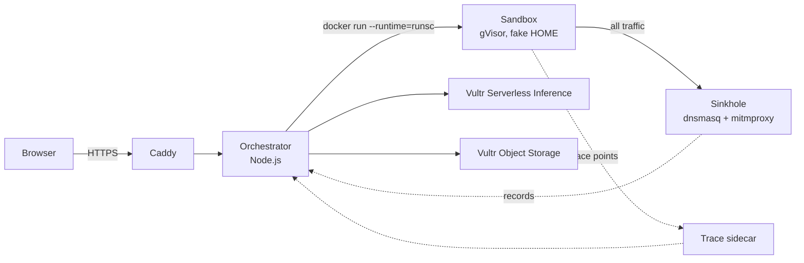

# FirstRun

Paste a command a website, video or chat told you to run, plus one line on what you were told it does. FirstRun runs it first in a throwaway gVisor sandbox on Vultr that looks like a developer laptop full of fake credentials, records everything it touches, and tells you whether the behaviour matches the claim.

Built for the Vultr "Agent Rush" hackathon on lablab.ai, Challenge 1 "Blast Radius Zero".

> Status: work in progress (day 1 infrastructure and server scaffold). Demo URL and video will be added here.

## Why

Copy-paste attacks such as ClickFix and fake install pages ask people to paste an obfuscated one-liner into their own terminal. The only advice people get is "check the command first", which nobody can do with a base64 chain. FirstRun checks it for them, without risking their machine.

## How it works

1. **Unwrap.** A deterministic decoder peels standard encodings; when hidden execution remains, an LLM on Vultr Serverless Inference writes a small harness that prints the next layer instead of running it, and the harness runs inside a network-less sandbox (Pattern A).
2. **Detonate.** The original command runs in a fresh `runsc` (gVisor) container with a read-only root filesystem, a tmpfs HOME seeded with per-run canary credentials, CPU, memory, process and 60-second limits, and no real secrets.
3. **Contain.** The container sits on a per-run internal Docker network whose only peer is a sinkhole: every DNS name resolves to it, TLS is terminated with a throwaway test CA, every request is recorded and answered locally, and nothing is forwarded.
4. **Observe.** gVisor trace points (exec, file open, connect) are streamed from outside the sandbox to a sidecar; the sinkhole records the network side.
5. **Decide.** Deterministic rules turn the evidence into CLEAN, SUSPICIOUS or MALICIOUS. The LLM only turns the claim into an expected-behaviour contract and explains the result; it never decides the verdict.
6. **Destroy.** Container, network and seed files are removed after every run; the report is stored in Vultr Object Storage with a shareable link.



## Vultr services

- **Cloud Compute** (Ubuntu 24.04): orchestrator, Docker with gVisor, sinkhole and trace sidecar on one VM.
- **Serverless Inference**: claim-to-contract, harness writer and explanation, all as validated JSON.
- **Object Storage**: one JSON report per run behind the share link.

## Setup (day 1)

On a fresh Ubuntu 24.04 VM with the repo at `/opt/firstrun`:

```bash
sudo bash infra/setup-vm.sh
sudo bash scripts/netcheck.sh          # network containment check
sudo bash scripts/trace-selftest.sh    # gVisor trace points reach the sidecar
node --env-file=/etc/firstrun/firstrun.env scripts/probe-vultr-inference.mjs
```

Set `FIRSTRUN_HOSTNAME=<your hostname>` when running `setup-vm.sh` to also configure Caddy with automatic HTTPS. Fill `/etc/firstrun/firstrun.env` (see `.env.example`) before the inference probe.

The full design, including every flag and its source, is in [docs/ARCHITECTURE.md](docs/ARCHITECTURE.md).

## Repository layout

- `server/`: orchestrator (Node.js, no framework)
- `sandbox/`: the decoy workstation image, shims for OS-specific tools
- `sinkhole/`: DNS, TLS and catch-all recorder image
- `infra/`: VM setup script, Docker runtimes, gVisor trace session and sidecar, systemd units, Caddyfile
- `scripts/`: test CA, image build, containment and trace checks, inference probe
- `docs/`: architecture and plan

## Safety

Only team-written, harmless test inputs are used for the demo; FirstRun never downloads or stores third-party payloads. Free-form commands on the public instance require an access code; curated samples are open to everyone.

## License

MIT, see [LICENSE](LICENSE).
