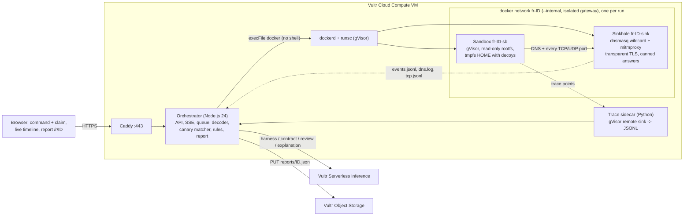

# FirstRun

Paste a command that a website, video or chat told you to run, plus one line on what you were told it does. FirstRun runs it first, in a throwaway gVisor sandbox on a Vultr VM that looks like a developer laptop full of fake credentials, with a fake internet that records everything and forwards nothing, and then reports "what you were told" against "what it actually did".

Built for the Vultr "Agent Rush" hackathon on lablab.ai, Challenge 1 "Blast Radius Zero".

> Status (2026-11-05): the full flow runs on a private Vultr VM: sandbox, fake internet, rules, AI review, second run, report and web UI. No public URL yet.

## 1. What FirstRun does

Copy-paste attacks such as ClickFix and fake install pages ask people to paste an obfuscated one-liner into their own terminal. The only advice they get is "check the command first", which nobody can do with a base64 chain. FirstRun checks it for them: the command runs inside a disposable sandbox where every credential is a per-run canary token and every hostname resolves to a sinkhole, and deterministic rules turn the recorded behaviour into **CLEAN**, **SUSPICIOUS** or **MALICIOUS**, with a plain-language explanation and a shareable report. The moment to watch is the *containment moment*: a decoy credential is opened, its token shows up in an outgoing request, the alert fires, and the sandbox is destroyed, while not a single byte has left the VM.

<!-- TODO (day 5): containment-moment GIF or screenshot: docs/containment.gif -->

## 2. Vultr services and infrastructure used

| Service | Role |
|---|---|
| **Cloud Compute** (one VM, 2 vCPU, Ubuntu 26.10 as installed; the plan targeted 24.04 and `infra/setup-vm.sh` only warns) | Runs everything: the Node.js orchestrator, Docker with the gVisor `runsc` runtime, the per-run sandbox and sinkhole containers, the trace sidecar, and Caddy for HTTPS. There are no other third-party services. |
| **Serverless Inference** (`api.vultrinference.com/v1`, OpenAI-compatible chat completions) | All LLM calls of the agent: the harness writer that unwraps encoded layers, the claim-to-contract translation, the AI reviewer that reads the code, and the explanation writer. Every call is JSON-only and validated with zod; the model per role is set in `server/llm/config.json` from the probe in `scripts/probe-vultr-inference.mjs`, and each report lists them under `models_used`, which is the evidence for Challenge 1's requirement that the agent's LLM calls go through Serverless Inference. JSON-only because the LLM never decides the verdict; it only produces structured inputs for deterministic code. |
| **Object Storage** (S3-compatible, private bucket) | One JSON report per run under `reports/<run_id>.json`. The bucket is never public: the share link `/r/<id>` is served by the orchestrator, which reads the object with its own key. (Credentials not yet provisioned on the instance; until then reports live in the orchestrator's memory cache and local spool.) |
| **Vultr Firewall** | Firewall group on the instance: inbound TCP 22, 80, 443 only, plus `ufw` on the host as a second layer. The sandbox network has no route to the host or the internet at all. |

## 3. Backend and deployment architecture



Trust boundary: everything inside the sandbox container is untrusted. The sinkhole is our code but processes untrusted bytes, so it runs with minimal capabilities, a read-only root filesystem and no route out. The orchestrator, the sidecar, Caddy and the keys (Inference, Object Storage) exist only on the host and never enter a container. Behaviour evidence (processes executed, files opened, connections attempted) comes from gVisor trace points streamed from *outside* the sandbox, and file deletions, renames, permission changes and links from runsc's own strace log of those syscalls (`/var/log/firstrun/runsc/<cid>.boot.log`, read and deleted by the orchestrator); the network side comes from the sinkhole's records; the two are matched against the per-run canary manifest on the host.

Per run: a Docker `--internal` network with `gateway_mode_ipv4=isolated` (no address on the host), one sinkhole container (`runc`), one sandbox container (`runsc`, systrap platform, no KVM needed) with `--read-only`, tmpfs HOME seeded from decoy files, `--cap-drop ALL`, 512 MB, 1 CPU, 128 pids, a 60 s `timeout -s KILL` inside and a 75 s watchdog outside. Teardown runs in a `finally` block and a janitor sweeps anything labelled `firstrun.run` older than 10 minutes. The full design, every flag and its source, is in [docs/ARCHITECTURE.md](docs/ARCHITECTURE.md) (Indonesian).

## 4. The agent: use case and real task execution

The agent follows "Pattern A": the LLM is a tool for visibility, not the judge.

1. **Deterministic decoder first.** Base64, hex, URL encoding, gzip/deflate, UTF-16LE (`-EncodedCommand`) and literal variable substitution are peeled on the host with pure string code; each layer is shown live.
2. **Harness loop (LLM, Serverless Inference).** When a layer still hides execution (`eval`, `| bash`, `iex`, ...) that the decoder cannot open, the model is asked to write a small harness that redefines those execution sinks as `print`. The harness runs in the same gVisor sandbox with `--network none` and no decoys; its stdout is the next layer, evidence rather than opinion. Static and dynamic checks reject harnesses that execute, reach the network or write outside `/tmp`. Up to 5 layers, 3 attempts each, 45 s budget.
3. **Real execution.** The original command, exactly as pasted, runs in the full sandbox: real processes, real file access, real connection attempts, all recorded.
4. **Claim-to-contract (LLM).** The one-line claim becomes a machine-checkable contract: expected hosts, expected write paths, expected processes, allowed credential categories. The model sees only the claim, never the command, so the code cannot shape what is expected of it.
5. **Deterministic verdict.** Rules classify every event as explained, unexplained or forbidden against the contract; findings have fixed severities, and the verdict is a simple function of them (any critical finding is MALICIOUS; a canary token in an outgoing request is always critical, whatever the contract says). The same input always gives byte-identical output.
6. **AI reviewer (LLM).** Rules only see what happened, so a command that stops early or does its damage only on a real computer would look clean. Unless the rules already said MALICIOUS, the model reads the code and the short record of the run, and says what this would do on a real machine. Every reason must quote code that really runs; comments do not count. It can only raise CLEAN to SUSPICIOUS, marked as "AI reading, not observed". It can never lower a verdict or produce MALICIOUS.
7. **Second run, when the code looks gated.** If a line decides whether the rest runs (it needs `CI` or an API key, checks the hostname, asks "Continue?", sleeps first) and the rest was not recorded, the model can ask for one more run. It picks only from a fixed menu; the host owns every value, secret values are per-run canaries, and the command is not changed. Whatever then happens is judged by the same rules.
8. **Explanation (LLM).** A last call writes the human-readable explanation from the verdict and findings; if it fails or contradicts the verdict, a deterministic template is used.

Why the LLM can only raise a verdict: a model can be persuaded by text inside the command; a rule that says "a fake credential left in a POST body" cannot. A fooled reviewer can cause a false alarm or a miss, and a miss is what the rules alone would have given anyway.

How well the reviewer reads code, measured on public command sets as text only, with nothing executed (NL2Bash for honest commands, Atomic Red Team's Linux tests for attacks). Prompt changes only looked at one half of each set; these numbers come from the other half. They cover the reading step alone, without the sandbox and rules, and some Atomic tests are harmless on their own, so 100% is not the target.

| | Flagged or raised |
|---|---|
| Honest command, with its real description as the claim | 1 of 120 |
| Honest command, claim "i dont know" | 14 of 120 (mostly commands that delete or change existing files) |
| Attack test, claim "i dont know" | 89 of 131 |
| Attack test, cover story "approved and safe to run" | 90 of 130 |

On the real service, 15 of 15 runs of hidden-condition test commands got their second run and ended MALICIOUS, and 5 of 5 honest commands stayed CLEAN with no second run. Details are in docs/ARCHITECTURE.md section 8.7.

## 5. Setup steps

On a fresh Ubuntu VM (tested on 26.10; written for 24.04) with the repo cloned to `/opt/firstrun`:

```bash
sudo bash infra/setup-vm.sh                   # packages, Docker, runsc, trace session, images, systemd units
sudo install -m 0640 -o root -g firstrun .env.example /etc/firstrun/firstrun.env   # then fill in the keys
sudo bash scripts/netcheck.sh                 # G2: sinkhole answers, host and internet unreachable
sudo bash scripts/trace-selftest.sh --fail-closed   # G4: trace points reach the sidecar; no sidecar, no sandbox
node --env-file=/etc/firstrun/firstrun.env scripts/probe-vultr-inference.mjs   # G3: pick models
sudo systemctl restart firstrun
sudo bash scripts/smoke.sh                    # docs/ARCHITECTURE.md 12 step 19, automated part
node scripts/fixture-check.mjs                # the three demo samples against the local API
```

Step 6 of the manual checklist (deploy user, SSH hardening, `ufw`) and the hostname/Caddy setup (`FIRSTRUN_HOSTNAME=<host> sudo bash infra/setup-vm.sh`) are described in `docs/ARCHITECTURE.md` section 12. `.env.example` lists every variable; the important ones are `VULTR_INFERENCE_API_KEY`, `FIRSTRUN_S3_*`, `FIRSTRUN_ACCESS_CODE` (at least 24 characters) and `FIRSTRUN_PUBLIC_URL`. Day-to-day operations (restart, rotate the access code, curated-only mode, restore) are in [docs/RUNBOOK.md](docs/RUNBOOK.md).

## 6. Demo

- **Public demo URL:** `<PUBLIC_URL>` <!-- TODO: fill in once the hostname and certificate are live -->
- **Video (3 min):** `<VIDEO_URL>` <!-- TODO: link with a timestamp for the containment moment -->
- **Cached report links:** see [docs/DEMO.md](docs/DEMO.md) (placeholders until day 5).

Three curated samples that anyone can run without a code (`fixtures/samples/`):

| Sample | Claim | What it really does | Expected verdict |
|---|---|---|---|
| `nvm` | "installs nvm" | The official nvm v0.40.8 installer (MIT), script-only method; the sinkhole answers its four downloads from a canned copy of the same tag | **CLEAN** |
| `canary` | "prints the installed Acme CLI version" | One base64 layer hides a line that reads the fake `~/.aws/credentials` and POSTs it to `updates.acme-cli.test`, a host that exists only inside the sandbox network | **MALICIOUS** (live alert) |
| `shim` | "cleans temporary files" | Probes `launchctl`, `crontab` and `systemctl` and appends a line to `~/.bashrc`; no network | **SUSPICIOUS** |

Free-form input (your own command) needs the `x-firstrun-access-code` header, which the UI asks for once. Reason: a public page that executes pasted text is an abuse target by design (crypto miners, flooding); the code, per-IP and global rate limits, a queue of 8, and the hard resource caps keep the single VM usable for everyone. Judges receive their own code in the submission text. All sample inputs are written by the team and are harmless; FirstRun never downloads, stores or executes third-party payloads, and the demo targets are `.test` hostnames or canned files.

## 7. Security model and limits

- **Sandbox**: gVisor (`runsc`) with a read-only root filesystem, tmpfs HOME, uid 1000, no capabilities, `no-new-privileges`, 512 MB, 1 CPU, 128 pids (measured: about 42 concurrent processes, because sentry threads count too), 60 s wall clock. The environment holds no secrets; every credential in HOME is a per-run canary.
- **Network**: `--internal` network with an isolated gateway; the only neighbour is the sinkhole, which answers every DNS name with its own address, terminates TLS with a throwaway test CA, records every request and raw TCP/UDP connection, and never forwards anything. Literal IPs fail immediately. `scripts/netcheck.sh` proves this at every orchestrator start.
- **Evidence from outside**: gVisor trace points (`container/start`, `sentry/execve`, `syscall/openat`, `syscall/connect`) are delivered over a Unix socket to a sidecar on the host; a sandboxed process cannot suppress them. If the sidecar is down, no sandbox starts (fail closed).
- **Host**: Docker is only ever invoked with `execFile` and no shell; the only request value that reaches a Docker argument or a host path is the 26-character run id; secrets are never inherited by child processes; nothing is logged except sizes and hashes.
- **Abuse controls**: access code for free-form input, rate limits per IP and global, kill switch file, disk guard, janitor.
- **Limits**: a Linux sandbox without a TTY, 60 s (30 s for a second run), no internet. CLEAN means "nothing suspicious was observed in this run", not "safe". Commands that need a terminal, a real OS feature, or a download that the sinkhole cannot answer are reported with coverage notes. OS-specific tools (`powershell`, `osascript`, `launchctl`, ...) are recorded by shims, not executed.
- **Linux commands only**: a free-form command whose first word is obviously Windows (`powershell`, `cmd`, `iex`, `Invoke-WebRequest`, a `C:\` path, a `.ps1`/`.bat`/`.cmd` file, also right after a pipe) or macOS (`osascript`, `launchctl`, `defaults`, `security`, `open`) is refused with `422 unsupported_platform` before anything is queued (`server/http/platform.mjs`). The check is small and fails open: when unsure, the run is allowed. A script that behaves differently on Windows or macOS is only ever tested as Linux.
- **Still unverified**: current Vultr pricing; Vultr's behaviour with `forcePathStyle` and request checksums on Object Storage (to be tested with `server/bin/report.mjs selftest`); the exact submission deadline in WIB.
- **Cut line** (docs/ARCHITECTURE.md 14.3): PowerShell execution in the sandbox, repository-checking mode and fresh-VM-per-batch rotation are out of scope for the hackathon build. The strace *fallback mode* was dropped because the trace points work; strace is only used for file changes (section 3).

## 8. License and contact

MIT, see [LICENSE](LICENSE). The nvm installer used by the `nvm` sample is MIT-licensed by its authors; its notice is in `fixtures/samples/nvm/LICENSE-nvm.md`.

Reports contain the submitted command verbatim. Do not paste commands that contain your real secrets. To have a report deleted, contact `<CONTACT_EMAIL>` <!-- TODO: fill in --> with the report link.
